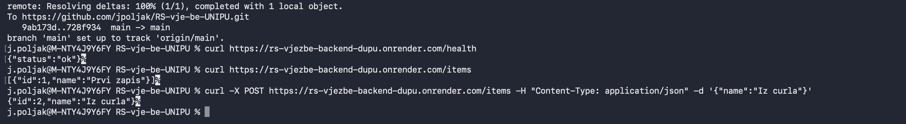
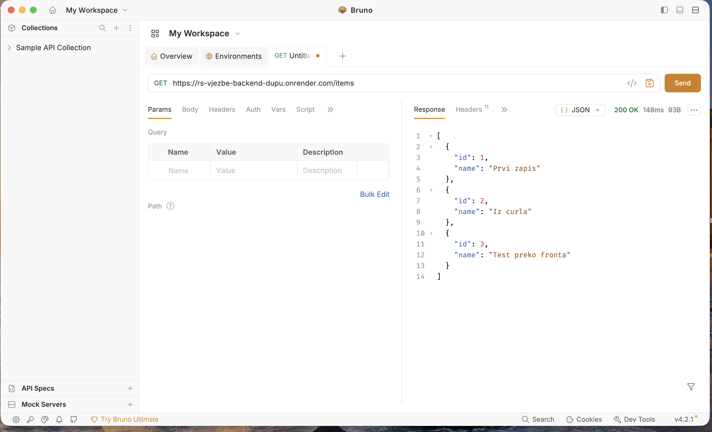
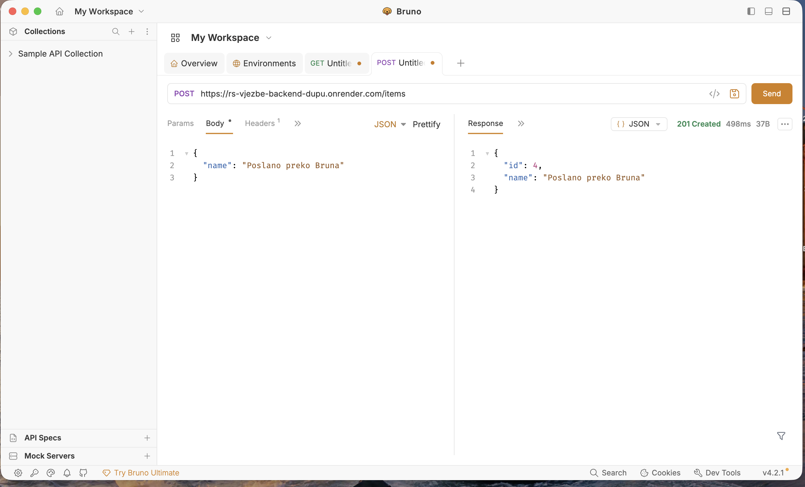

# backend_app

Jednostavan REST API u FastAPI-ju (podaci se čuvaju u memoriji).

**Javni URL (Render):** https://rs-vjezbe-backend-dupu.onrender.com

## Endpointi

| Metoda | Putanja | Opis |
|---|---|---|
| GET | `/` | poruka dobrodošlice |
| GET | `/health` | provjera rada |
| GET | `/items` | popis zapisa |
| GET | `/items/{id}` | jedan zapis |
| POST | `/items` | novi zapis, body `{"name": "..."}` |
| DELETE | `/items/{id}` | brisanje zapisa |

Automatska dokumentacija: `/docs`

## Lokalno pokretanje

```bash
python3 -m venv .venv && source .venv/bin/activate
pip install -r requirements.txt
uvicorn main:app --reload
```

## Render (Web Service)

- Root Directory: `vjezbe_1/backend_app`
- Build Command: `pip install -r requirements.txt`
- Start Command: `uvicorn main:app --host 0.0.0.0 --port $PORT`

## Screenshotovi testiranja

curl:



Bruno (GET):



Bruno (POST):



## Testiranje (curl)

```bash
curl URL/health
curl URL/items
curl -X POST URL/items -H "Content-Type: application/json" -d '{"name":"Novi zapis"}'
curl -X DELETE URL/items/1
```
